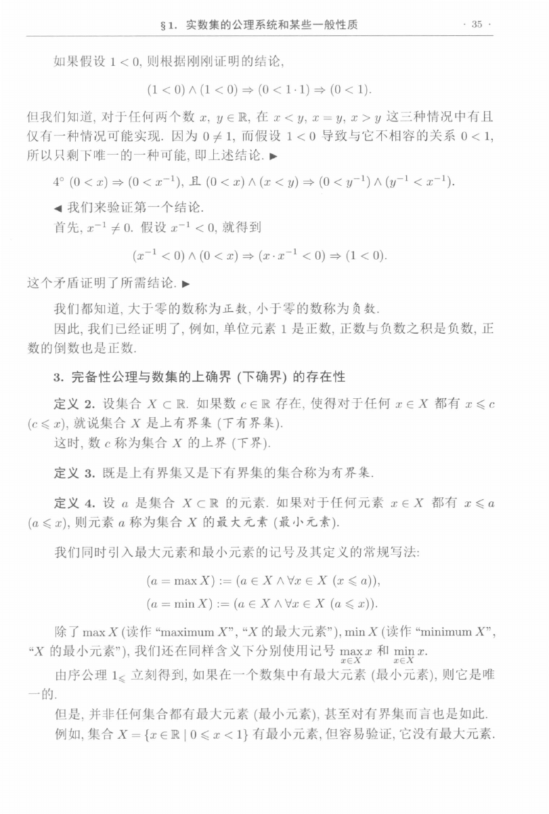
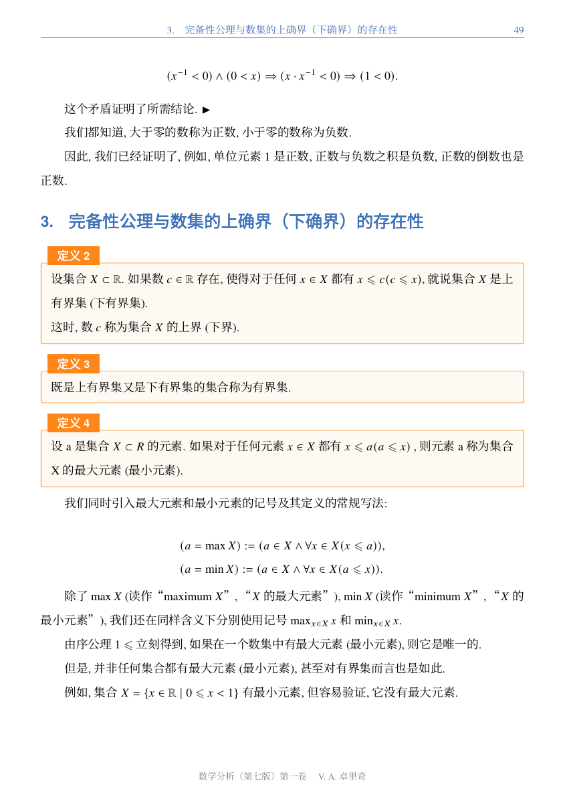
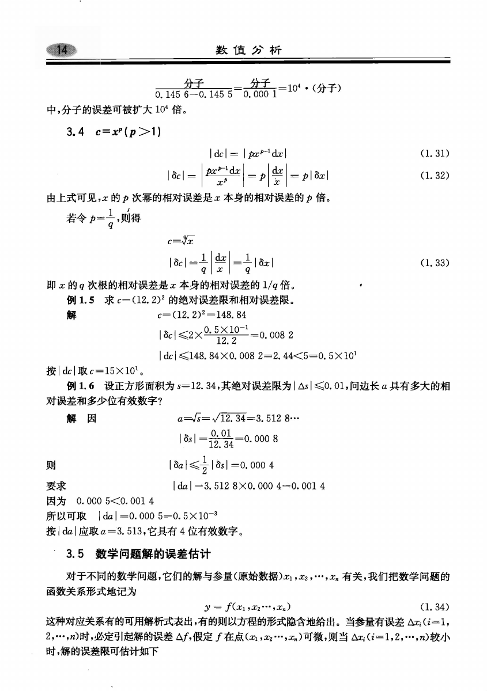
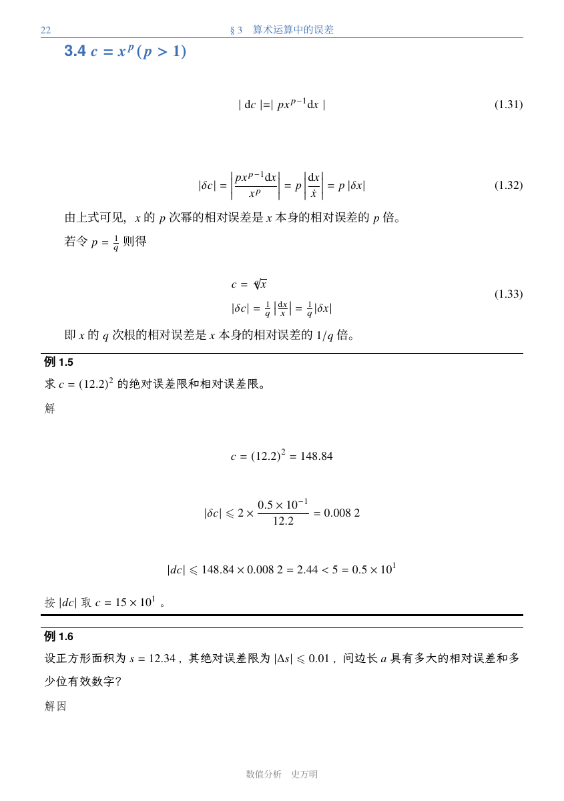
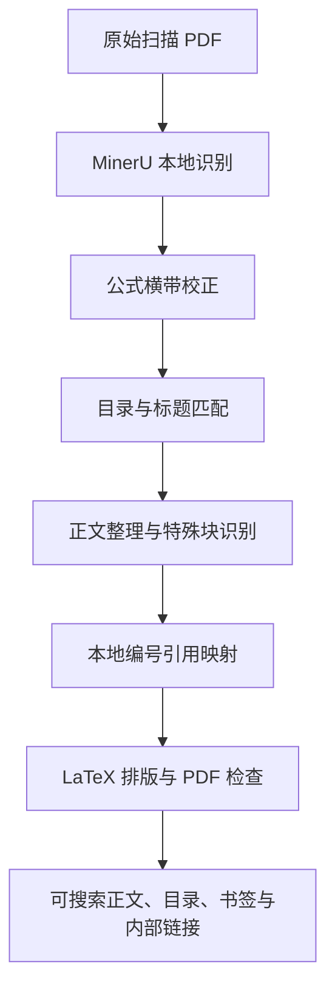

# PDF 回炉所 · PDF Reforge

将扫描版、图片型 PDF 转换为可搜索、可选择和复制正文的文本 PDF，并重新整理目录、标题、公式、定理与例题的排版。项目主要面向有原书目录的中文数学教材，使用 **MinerU 本地识别 + DeepSeek 结构判断 + LaTeX 排版**，同时保留原稿、识别数据和处理记录，方便对照复核。

## 一、效果展示

下面的截图来自项目实际处理过的《数学分析（第七版）第一卷》和《数值分析》。左侧为原始扫描页，右侧为转换后的 PDF 页面。转换会重新分页，因此两侧展示的是对应内容，页码不必相同；标注的页码均为 PDF 阅读器中从 1 开始的物理页码。

### 数学分析：从扫描文字到结构化书稿

原稿中的正文、数学符号和定义经过识别后重新排版，章节标题与定义块使用独立样式，正文可以搜索、选择和复制。

| 转换前：原 PDF 第 56 页 | 转换后：新 PDF 第 68 页 |
| --- | --- |
|  |  |

### 数值分析：公式与例题重新排版

正文中的公式按数学语法重新排版，保留公式编号；例题区分题目与解答，并使用单独的边线样式。原页底部的后续内容会随新版式继续排到下一页。

| 转换前：原 PDF 第 22 页 | 转换后：新 PDF 第 26 页 |
| --- | --- |
|  |  |

为确认输出具备文字层，对上述页面使用 PyMuPDF 的 `page.get_text().strip()` 提取文本，结果如下。字符数包含标点、空白和可提取的数学字符。

| 示例页面 | 原始扫描页可提取字符数 | 转换页可提取字符数 |
| --- | ---: | ---: |
| 数学分析：原第 56 页 → 新第 68 页 | 0 | 708 |
| 数值分析：原第 22 页 → 新第 26 页 | 0 | 466 |

例如，数学分析的转换页可以直接提取出以下文字：

```text
定义3
既是上有界集又是下有界集的集合称为有界集.
```

除正文重排外，输出还包含可点击目录、PDF 书签，以及能够明确匹配的编号引用跳转。插图仍使用图片；复杂表格和无法可靠编译的部分公式也可能保留原图，具体限制见第四部分。

仓库仅包含程序、配置、排版资源及少量效果截图，完整原书、OCR 数据、模型缓存与生成的 PDF 保存在本地，不随仓库分发。

## 二、安装方法

### Docker 安装（推荐）

Docker 镜像包含 Python、MinerU 4.0.10、XeLaTeX、latexmk、必要宏包和中文字体，宿主机无需逐项安装这些依赖。先安装 [Docker Engine](https://docs.docker.com/engine/install/) 和 [Docker Compose 插件](https://docs.docker.com/compose/install/)，在项目根目录执行：

```bash
# 首次使用时复制；已有 .env 的环境直接复用，不要覆盖密钥
cp .env.example .env
```

编辑 `.env`，填写 `DEEPSEEK_API_KEY`，并确认 `book_config.json` 中的接口与模型支持图片输入和 JSON 输出。然后启动：

```bash
docker compose up -d --build
```

打开 [本地网页界面](http://localhost:8765)，上传 PDF 即可开始处理。第一次构建需要下载 Python 依赖和 TeX 资源，第一次识别还需下载 MinerU 模型；后续启动会复用镜像与模型缓存。

默认启动使用 **CPU + ONNX / llama.cpp**，保留项目的 `standard` 识别档位，无需配置显卡，但长书识别可能较慢。Linux NVIDIA 主机可以使用下面的 GPU 配置，让 llama.cpp 的视觉语言模型通过 Vulkan 使用显卡；版面、OCR 等 ONNX 小模型仍在 CPU 上运行。两种方式共用镜像和模型缓存。后端与硬件要求见 [MinerU 官方说明](https://opendatalab.github.io/MinerU/usage/tiers/)。

#### NVIDIA 显卡推理

宿主机需要已安装 NVIDIA 驱动和 [NVIDIA Container Toolkit](https://docs.nvidia.com/datacenter/cloud-native/container-toolkit/latest/install-guide.html)，并已为 Docker 配置 `nvidia` 运行时。`nvidia-smi` 应能列出显卡，`docker info` 的 Runtimes 应包含 `nvidia`。在项目根目录启动：

```bash
docker compose -f compose.yaml -f compose.gpu.yaml up -d --build
```

默认使用 NVIDIA 设备 `0`，多卡机器可在 `.env` 中设置 `PDF_REFORGE_GPU_ID`。GPU 配置同时启用 NVIDIA 运行时和 `compute,utility,graphics` 驱动能力，让容器取得 Vulkan 驱动及其描述文件；镜像包含无图形界面推理所需的 EGL 库，无需安装桌面环境或另一套模型。显存需求取决于输入和推理并发，本项目使用的 `standard` 模型已在 8 GB RTX 4060 Laptop GPU 上验证。

GPU 模式每次启动都会运行 llama.cpp 的真实设备检查，日志应出现 `GPU 推理已启用（llama.cpp / Vulkan）` 和显卡名称。没有可用 Vulkan GPU 时启动失败，不静默改成 CPU。单独检查设备：

```bash
docker compose -f compose.yaml -f compose.gpu.yaml run --rm pdf-reforge true
```

GPU 模式中的其他 Compose 操作也带上这两个 `-f` 参数，例如查看日志、重启服务和运行转换：

```bash
docker compose -f compose.yaml -f compose.gpu.yaml logs -f pdf-reforge
docker compose -f compose.yaml -f compose.gpu.yaml run --rm pdf-reforge python main.py \
  --pdf input_pdfs/book.pdf --metadata input_pdfs/book.book.yaml -o output/book
```

切回 CPU 模式可执行 `docker compose -f compose.yaml up -d --force-recreate`。输入、模型缓存和 `output/docker/` 下的结果会继续保留。

| 配置或数据 | 容器使用方式 |
| --- | --- |
| `.env` | 启动时传入环境变量，密钥不进入镜像 |
| `book_config.json` | 只读挂载，修改接口或排版配置后执行 `docker compose restart` |
| `input_pdfs/` | 只读挂载，可供容器中的命令行使用；网页上传不需要先放到此目录 |
| `output/docker/` | 保存容器生成的输入副本、任务、识别缓存与 PDF；网页结果位于其中的 `web/` |
| `model-cache` 数据卷 | 保存 MinerU 模型及下载缓存，重建容器后可继续复用 |

容器输出与原生运行的 `output/web/` 分开保存，避免混用含本机绝对路径的旧任务。构建上下文仅包含程序、配置和排版资源，不打包 `.env`、原始书籍、历史输出或本机虚拟环境。

常用命令：

```bash
docker compose logs -f pdf-reforge
docker compose run --rm pdf-reforge python main.py --check
docker compose down
```

`docker compose down` 停止服务并保留输出和模型数据卷。端口被占用时，在 `.env` 中将 `PDF_REFORGE_PORT` 改为其他端口，例如 `8766`，再运行 `docker compose up -d`，通过对应端口访问。首次模型下载失败时，可将 `book_config.json` 的 `mineru_model_source` 改为可用的 `huggingface` 或 `modelscope`。

也可以在容器中运行命令行转换；先在本机准备 `input_pdfs/book.pdf` 和填写好的 `input_pdfs/book.book.yaml`：

```bash
docker compose run --rm pdf-reforge python main.py \
  --pdf input_pdfs/book.pdf \
  --metadata input_pdfs/book.book.yaml \
  -o output/book
```

对应 PDF 保存在本机 `output/docker/book/pdf/latex/main.pdf`。

### 本地手动安装

当前项目在 **Linux / Python 3.12** 环境下验证。需要准备 Python 依赖、XeLaTeX、latexmk 和中文字体；从原始 PDF 开始转换时，还需要安装 MinerU。

#### 1. 创建环境并安装 Python 依赖

在项目根目录执行，先确保系统已安装 Python 3.12 及对应的 `venv` 支持：

```bash
python3.12 -m venv .venv
source .venv/bin/activate
python -m pip install --upgrade pip
python -m pip install -r requirements.txt
```

按使用方式安装额外依赖：

```bash
# 从原始 PDF 开始识别时安装，当前锁定 MinerU 4.0.10
python -m pip install -r requirements-mineru.txt

# 使用本地网页界面时安装，会一并安装基础依赖
python -m pip install -r requirements-web.txt
```

| 依赖文件 | 作用 |
| --- | --- |
| `requirements.txt` | API 调用、PDF 读写、图片处理和 YAML 配置，包含 OpenAI SDK、HTTPX、PyMuPDF、Pillow、PyYAML |
| `requirements-mineru.txt` | 本地 OCR 与版面识别；已有本项目导出的完整 MinerU 结果时可跳过 |
| `requirements-web.txt` | 本地网页服务，包含 FastAPI、Uvicorn 和上传文件所需的依赖 |

MinerU 首次识别时需要准备模型文件。模型来源可在 `book_config.json` 的 `mineru_model_source` 中设置为 `auto`、`huggingface`、`modelscope` 或 `local`；其中 `local` 只使用已经下载的模型。识别耗时和资源占用取决于书籍页数、识别档位及本机配置。

#### 2. 安装排版工具与中文字体

Ubuntu / Debian 环境下先安装字体、latexmk 所需的 Perl，以及 TeX 安装时使用的下载工具：

```bash
sudo apt-get update
sudo apt-get install -y fonts-noto-cjk fontconfig perl curl
fc-cache -f
```

然后安装项目需要的 TeX 环境：

```bash
python install_book_tex.py
```

脚本支持 Linux x86_64 / aarch64，会下载 TinyTeX 并将所需宏包安装到项目的 `.tools/` 中，程序可自动找到其中的 XeLaTeX 与 latexmk。已有完整 TeX Live 的环境可直接使用，但仍需具备项目所用宏包；其他系统需自行安装 TeX Live、latexmk 和对应字体，兼容性尚未完整验证。

默认正文使用 `Noto Serif CJK SC`，标题使用 `Noto Sans CJK SC`，图注使用仓库附带的霞鹜文楷。可以通过 `book_config.json` 的 `main_font`、`heading_font`、`caption_font_file` 修改字体。模板与字体来源分别见 [模板来源记录](book_templates/PROVENANCE.md) 和 [字体许可证](models/font_candidates/LxgwWenkaiGB/OFL.txt)。

#### 3. 配置模型接口并检查环境

```bash
cp .env.example .env
```

在 `.env` 中填写自己的密钥：

```dotenv
DEEPSEEK_API_KEY=your_key_here
```

检查 `book_config.json` 中的 `base_url`、`model` 与 `api_key_env` 是否对应你可用的服务。目录读取和公式横带校正会发送图片，因此配置的接口与模型需要同时支持**图片输入和 JSON 输出**。`concurrency` 控制并发请求数，`attempts` 控制普通请求重试及连续服务故障的重试次数；公式编译修复使用下述持续反馈循环。配置中的 `pricing` 仅用于估算费用，需按实际服务更新。

```bash
# 检查本地排版工具、必要宏包及图注字体文件
python main.py --check-local

# 在上述检查基础上，检查 API 密钥是否存在
python main.py --check
```

这两个命令均不发送模型请求，也不会验证密钥有效性、接口连通性或模型能力。可用 `fc-match 'Noto Serif CJK SC'` 和 `fc-match 'Noto Sans CJK SC'` 另行确认系统字体匹配是否正确。

#### 4. 开始使用

**网页入口**适合上传书籍、查看处理进度和调整排版：

```bash
source .venv/bin/activate
python serve.py --port 8765
```

打开 [本地网页界面](http://localhost:8765)，上传 PDF 并填写书名、作者。识别与正文整理完成后，在“排版样式”中调整字号、配色并生成样例预览，确认效果后点击“生成整本 PDF”。任务和各次排版结果保存在 `output/web/`。

**命令行入口**适合按固定配置运行完整流程。先将自己的 PDF 放到 `input_pdfs/book.pdf`，复制元数据示例：

```bash
mkdir -p input_pdfs
cp book_metadata.example.yaml input_pdfs/book.book.yaml
```

编辑该 YAML，填写书名、作者，例如：

```yaml
book:
  title: "我的教材"
  author: "作者姓名"
exclude_pages: []
```

书名和作者只读取用户输入，不从文件名或模型结果猜测。`exclude_pages` 填原 PDF 中从 1 开始的物理页码，用于排除封面、版权页等内容；不要填书内印刷页码。目录通常自动定位，也可通过 `book_config.json` 的 `toc_pages` 指定原 PDF 物理页码。

运行完整转换：

```bash
python main.py \
  --pdf input_pdfs/book.pdf \
  --metadata input_pdfs/book.book.yaml \
  -o output/book
```

最终 PDF 位于 `output/book/pdf/latex/main.pdf`。如果已有完整的 MinerU 结果，可以跳过本地识别：

```bash
python main.py \
  --pdf input_pdfs/book.pdf \
  --mineru-dir output/book/mineru \
  --metadata input_pdfs/book.book.yaml \
  -o output/book/reforged
```

此时最终 PDF 位于 `output/book/reforged/pdf/latex/main.pdf`。复用的识别目录需包含 `manifest.json`、`middle_json.json` 和图片资源，且清单中的 PDF 校验值必须与输入文件一致，不能直接拿任意 Markdown 文件替代。

## 三、流程介绍

完整转换先进行本地 OCR 和公式校正，再依次恢复标题、整理正文、建立引用、生成 PDF：



| 阶段 | 主要工作 | 是否使用模型 |
| --- | --- | --- |
| MinerU 识别 | 逐页提取文字、公式、图片、表格和坐标，保存结构化 JSON、Markdown 及图片资源 | 本地识别模型 |
| 公式横带校正 | 检测独立公式与文字在上下范围重叠的区域，从原 PDF 截取整页宽横带，重新识别文字、公式及编号归属 | DeepSeek 图片输入 |
| 目录与标题匹配 | 读取原书目录，匹配正文标题、层级和位置，并标记习题及答案/解析章节 | DeepSeek 目录读取与判断，配合本地匹配 |
| 正文整理 | 删除页眉、页脚和页码；判断跨页段落是否合并；识别定理、定义、例题、编号小标题和脚注关系 | 本地规则 + DeepSeek 范围判断 |
| 引用映射 | 根据“类型 + 编号”查找引用目标，为可以唯一确定的引用生成内部跳转 | 本地规则 |
| 排版与检查 | 生成 LaTeX，设置标题和特殊块样式，处理公式、图表与脚注，编译 PDF 并检查覆盖、边界和链接 | 本地排版；定位到公式或表格编译错误时用 DeepSeek 原图反馈修复 |

正文整理会先用本地候选集合扫描段首或换行后的关键词、编号形式，再让模型判断命中的候选及其范围。定理等块只包含表述，证明继续作为正文；例题分别记录题目与解答。习题以及答案、参考答案、解析、课后答案、课后解析等章节和其子范围跳过编号小标题识别，避免把题号、答案编号误判为标题；原文和原目录中已匹配的章节标题保留。普通教学章节中的“解析几何”等不因此屏蔽。候选集合可在网页“匹配规则”中修改，也可通过配置文件的 `keyword_candidates` 设置。

最终被丢弃的特殊块身份不参与例题边界或模块重叠检查，原文按普通正文保留。若边界复核使某类对象的确认数降到保留门槛以下，会撤销该身份造成的边界限制及报错，从独立判断重建结果；真实保留对象的边界和独立判断失败仍正常检查。

匹配脚注时只查同一原物理页，引用点和注释标号均唯一时才建立关系；已匹配脚注在最终输出页中重新编号。图表优先保留原有内容，同排图片尽量按原书左右关系组合，较大的图表允许移动到后续页面。

目录条目直接由原目录图片解析，按正常分栏阅读顺序保存标题、层级和印刷页码；没有印页码的条目保存为 null，不补造页码。每项记录目录图片哈希及区域，解析请求不携带目录 OCR，也不使用其字符串顺序作否决条件。随后用正文 OCR 搜索、匹配标题并建立实际来源锚点，保留重复匹配、层级及正文顺序的校验。

带下标或上标的公式编号会按数学模式排版，保留原编号。若公式仍导致编译失败，程序根据生成源码里的来源标记定位公式，使用已有公式图片或从原 PDF 坐标裁图，交给 DeepSeek 输出兼容的 LaTeX。先用当前公式产生含宏展开上下文的准确报错；每次失败都把原图、上一份失败代码、准确编译报错和实际模板上下文送回模型，持续反馈到候选通过本书的 XeLaTeX 验证。回复因输出额度耗尽而截断时，下一轮改为直接返回代码，保留同一原图和反馈；其他任务的思考设置不变。随后重新生成并编译整书，整书中仍报错则继续反馈。默认不设公式修复轮数上限，反馈历史保留最近三轮，避免请求上下文无限增长；可主动中断，反馈与已验证替换均可恢复。连续接口故障、取消或无法定位原公式时保留失败状态。只保存排版替换，不改写原始 OCR、正文整理结果或来源锚点。原图、回复、验证和历次编译保存在 `pdf/reports/formula_repair/` 与 `pdf/reports/compile_history/`。

表格单元格中出现不配对的数学分隔符或花括号时，沿用复杂表格的原图保留方式。原生表格的编译错误按独立来源标记定位，将原图、当前表格代码、实际报错和模板环境发送给 DeepSeek，持续反馈到候选通过本书 XeLaTeX 校验，再重新编译整书。模型只调整含单元格占位符的排版模板；全部单元格按原顺序逐字填回，不能删行、改写内容或换成图片来绕过报错。公式与表格各自保存可恢复替换，表格证据位于 `pdf/reports/table_repair/`。无明确来源的错误仍真实报失败。

**处理结果可以复用。** MinerU 每完成一页就保存带校验信息的缓存，中断后以相同参数重跑可复用已完成页面；模型请求也保存经过校验的响应缓存。标题、正文整理和引用映射分别写入独立目录，调整排版时可以直接读取已有结果，无需重新 OCR 或再次判断正文。

命令行通过 `--correct-formulas`、`--match-headings`、`--process-sections`、`--map-references` 和 `--render-processed-book` 单独执行阶段，具体参数见 `python main.py --help`。分阶段运行时，后续步骤需通过 `--formula-corrections` 传入同一份公式校正结果，以保持来源版本一致。

完整命令行流程的主要产物如下：

```text
output/book/
├── mineru/                 # OCR 原始结果与图片
├── mineru_cache/           # 逐页识别缓存
├── formula_corrections/    # 公式横带截图、二次识别结果与用量
├── headings/               # 目录、标题匹配及疑点记录
├── content/                # 正文分块、特殊块与脚注处理记录
├── references/             # 编号对象、引用目标与歧义候选
└── pdf/
    ├── latex/              # LaTeX 源码及 main.pdf
    └── reports/            # 编译、来源覆盖、页面和导航检查
```

MinerU 推理在本地进行；目录图片、公式横带截图、编译失败公式与表格的原图及代码，以及正文整理所需的文字片段会提交给配置的模型接口。接口调用会产生费用，记录中的 token 用量与费用估算可用于核对消耗。

## 四、已知缺陷

当前输出适合作为重新排版和阅读的书稿，仍需要对照原书校勘。已对样例教材进行整书处理、自动检查及重点页面人工复核，尚未完成全书逐字、逐符号核对。

| 可能出现的问题 | 具体表现与当前处理方式 |
| --- | --- |
| **文字与公式识别错误** | 模糊扫描、复杂上下标、矩阵、分段公式、相似字母或符号可能识别错误，例如负号遗漏、大小写混淆、不等号方向错误。公式横带校正只能改善部分区域，正文整理不承担通篇 OCR 纠错。 |
| **标题与特殊块误判** | 目录不完整、标题与正文混排、编号格式特殊时可能漏掉标题，或把普通列表识别为小标题；连续编号补回也可能误补列表项。默认候选初筛要求出现至少 10 处，最终每类确认数须超过 10 才保留特殊样式，因此少见类型可能仍按普通正文排版，文字会保留。 |
| **段落与内容范围不准确** | 跨页续句、证明起止、例题题目与解答的边界可能判断不准，表现为不该合并的段落被合并、题解划分不理想或特殊块范围过大、过小。 |
| **部分内容仍是图片** | 插图、复杂表格，以及带有多个冲突编号、残缺编号或不兼容编号语法的公式可能保留原图。这些区域不能保证搜索或复制，输出并非所有元素都转成可编辑文本。 |
| **数学公式复制结果不完整** | 公式可以正确显示，但从 PDF 复制时，根号、积分、分数、上下标等可能变成分散字符或顺序混乱的文本，不能保证直接复制为 LaTeX。 |
| **引用和脚注无法全部匹配** | 重复编号、无编号指代、脚注缺少标记或同页存在多个候选时，无法唯一确定关系。程序保留原文并记录疑点，部分引用没有跳转，部分脚注保留原标号。 |
| **页码、图表位置与原书不同** | 字体、字号和标题规则改变后会重新分页，图表可能浮动到后续页，长例题可能跨页续排，也可能产生留白。内容覆盖与页面边界检查不能代替人工阅读检查。 |
| **适用书籍与运行环境有限** | 目前主要验证有原始目录的中文数学教材；无目录、手写批注、多栏或复杂杂志版式的效果尚未充分验证。长书的本地识别与整书编译可能耗时较长，模型接口的限流、超时或能力不匹配也会中断处理。 |

建议先查看真实样例预览，再生成整本书；生成后重点核对定义、定理、公式编号、关键数值、脚注和图表，并结合输出目录中的未匹配记录与检查报告定位问题。自动检查通过只表示相应检查项通过，不代表数学内容已经校对正确。
